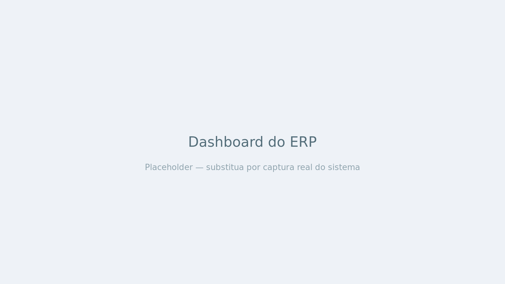
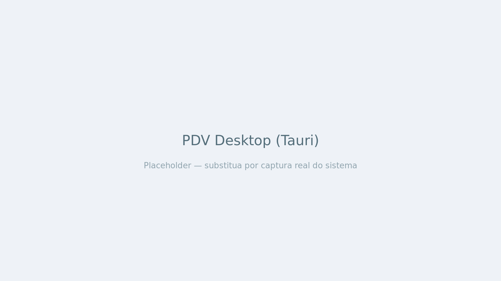
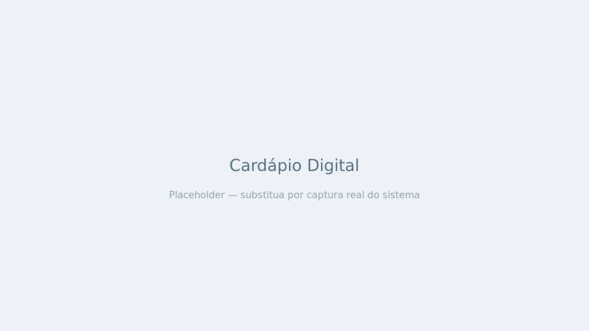
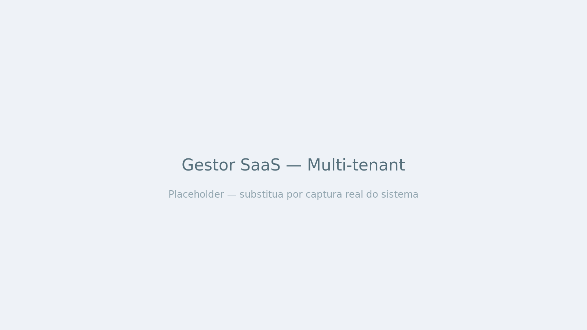
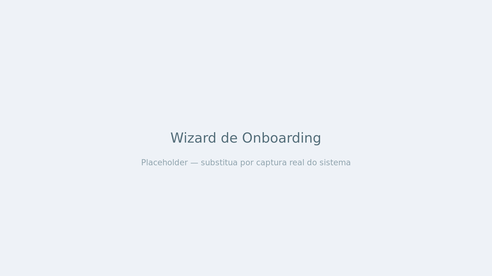
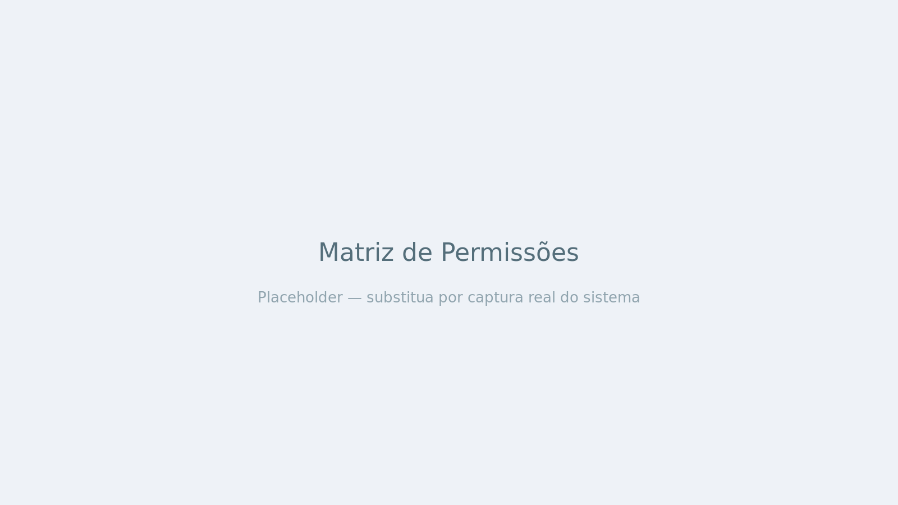
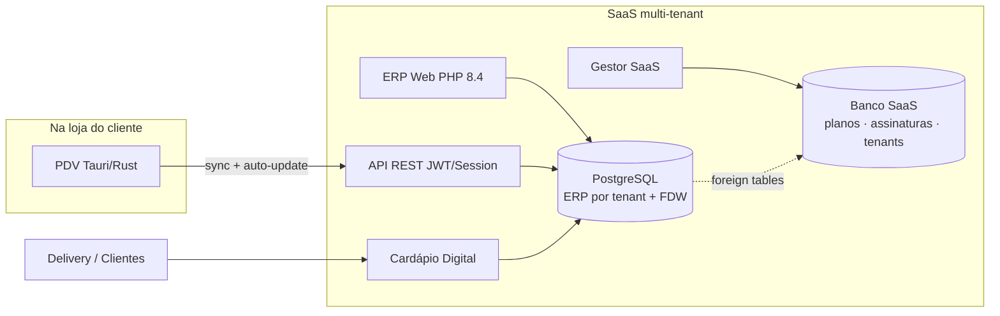

# SIGE — Sistema Integrado de Gestão Empresarial

**Um SaaS completo para pequenas e médias empresas: ERP, PDV, cardápio digital, delivery e gestão financeira em uma única plataforma multi-tenant.**

-FFC131)

*Projeto pessoal · Desenvolvido do zero, do banco de dados ao instalador desktop*

---

## 🎯 O problema

Pequenos negócios (bares, restaurantes, lojas, delivery) operam com **3 a 5 ferramentas desconectadas**: um ERP caro, um sistema de PDV à parte, um app de delivery com comissões abusivas, planilhas de estoque e um caderno para o financeiro. O resultado é **dado duplicado, erro de caixa, fura de estoque e zero visão do negócio**.

## 💡 A solução

O SIGE integra **tudo em uma só plataforma**, com um dado de verdade único:

| Você precisa de... | No SIGE é... |
|---|---|
| Frente de caixa rápida e confiável | **PDV Desktop** (Rust/Tauri) com modo offline e sincronização automática |
| Vender online sem comissão | **Cardápio digital + delivery** próprios, com pedidos direto no caixa |
| Controlar estoque e compras | **Estoque** com movimentações, inventário e política de venda negativa configurável |
| Saber se está dando lucro | **Financeiro** (contas a pagar/receber), relatórios e dashboard |
| Gerenciar equipe e permissões | **Matriz de permissões granular** por papel, módulo e operação |
| Crescer para várias lojas | Arquitetura **multi-tenant e multi-loja** pronta desde a fundação |

---

## 📸 O produto

### ERP Web

### PDV Desktop (Tauri 2.0)

### Cardápio Digital

### Gestor SaaS — visão multi-tenant

### Onboarding guiado de novos clientes

### Controle de acesso fail-closed

---

## 🧩 Os módulos

| Módulo | O que resolve |
|---|---|
| 🛒 **PDV Desktop** | Venda offline-first com sync automático, impressão de cupom, controle de caixa por turno/terminal e auto-update assinado |
| 🍔 **Cardápio Digital + Delivery** | Pedidos online com slug próprio por tenant, mesa, retirada e delivery — direto no caixa, sem intermediário |
| 📦 **Estoque** | Inventário inicial, movimentações, fornecedores e política de estoque negativo por produto |
| 💰 **Financeiro** | Contas a receber/pagar, formas de pagamento com taxas, comissões de vendedores e estorno seguro |
| 👥 **Clientes & Fidelidade** | Cadastro, pontos, cashback e histórico de compras |
| 📄 **Fiscal** | NFS-e, impostos por produto, SPED e manifestação (o cliente pode operar sem NF — módulo oculto pelo plano) |
| 🔐 **Permissões** | Papéis granulares (leitura/escrita) com padrão **negar**: ação sem permissão explícita = bloqueada |
| 🧭 **Onboarding de implantação** | Wizard que mede o que falta para o cliente operar (empresa, usuários, caixa, estoque, cardápio) |
| 📧 **E-mail transacional** | Templates e fila de e-mails com SMTP por tenant |
| 📊 **Relatórios & Exportação** | Vendas, estoque e financeiro exportáveis |

---

## 🏗️ Arquitetura — em uma imagem

**Decisões que sustentam o produto:**

- **Multi-tenancy via FDW** — isolamento lógico com custo zero de infraestrutura por cliente, e caminho de migração para banco-a-banco quando necessário.
- **PDV em Rust/Tauri** — binário leve (vs Electron), auto-update assinado criptograficamente e operação offline para lojas com internet instável.
- **Session + JWT lado a lado** — sessão revogável no ERP web, tokens para PDV/mobile/API, com 2FA TOTP.
- **PHP puro + PostgreSQL** — sem frameworks pesados: manutenção simples, deploy rápido e stack que qualquer equipe consegue manter.

---

## 🔒 Segurança tratada a sério (desde o primeiro commit)

- **Permissões fail-closed**: 258 ações de negócio mapeadas a módulo + operação; ação fora do mapa é **negada por padrão** — e o gate de regressão **falha** se alguém adicionar uma ação sem mapeá-la.
- **Multi-tenant**: nenhum cliente enxerga dados de outro (isolamento no banco + contexto de tenant em toda query).
- **2FA TOTP**, proteção contra brute-force (Nginx + aplicação), CSRF, CSP por host, TLS Full Strict via Cloudflare.
- **Trilha de auditoria**: eventos de segurança registrados, backups automáticos do banco, firewall e fail2ban na infraestrutura.

---

## 📈 Números do projeto

| | |
|---:|---|
| **155** migrations idempotentes sequenciais | **258** ações de negócio sob controle de permissão |
| **145** tabelas (ERP + SaaS) | **67** módulos contratáveis por plano |
| **28** verificações automatizadas no gate de QA | **8** subdomínios (ERP, Gestor, API, Cardápio, Portal, Landing, PDV, Docs) |
| **v1.27.0** em produção | **100%** do sistema construído por uma pessoa |

---

## 🗺️ Roadmap

- ✅ **v1.26** — Suite fiscal completa (NFS-e, impostos, SPED)
- ✅ **v1.27** — Trava anti-fraude fail-closed + onboarding guiado de clientes
- 🔜 **v1.28+** — PIX/boleto/CNAB, multi-loja operacional, reativação da suíte E2E de venda
- 🔭 **Horizonte** — marketplaces, BI avançado, app do cliente, parcerias com contadores

Detalhes na [review de produto](docs/REVIEW-PRODUTO.md) e no [roadmap](docs/ROADMAP.md).

---

## 🧑‍💼 Sobre este projeto

O SIGE é um produto **real, em operação com cliente pagante**, construído por mim — Leonardo Ribeiro ([@leonardosanrn](https://github.com/leonardosanrn)) — de ponta a ponta: modelagem de banco, backend, frontend, PDV desktop em Rust, infraestrutura, deploy e o processo de QA automatizado.

> ⚠️ **Este repositório é a vitrine pública do produto.** O código-fonte é proprietário e vive em repositórios privados — disponível para demonstração em processos seletivos e conversas com investidores e parceiros.

**Quer ver o sistema rodando?** Fale comigo: [linkedin](https://linkedin.com/in/SEU-LINKEDIN) · e-mail · [seusige.com](https://seusige.com)

---

© 2026 SIGE — Sistema Integrado de Gestão Empresarial. Todos os direitos reservados.

